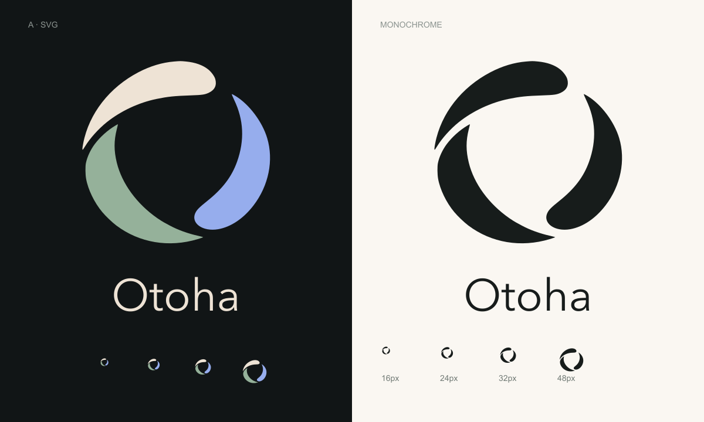

# Otoha 暂定标识

当前采用用户选定的 **A · 共振环**，状态为暂定，后续可替换。SVG 保留三个独立形状、原构图和配色；主标为可编辑路径，没有嵌入图片或外部依赖。

| 资产 | 文件 |
| --- | --- |
| 彩色透明主标 | [otoha-mark.svg](otoha-mark.svg) |
| 单色透明主标 | [otoha-mark-mono.svg](otoha-mark-mono.svg) |
| 圆角应用图标 | [otoha-icon.svg](otoha-icon.svg) |
| PNG 导出 | [32px](otoha-icon-32.png)、[64px](otoha-icon-64.png)、[128px](otoha-icon-128.png)、[512px](otoha-icon-512.png) |
| 选择与色值 | [selection.json](selection.json) |

深色界面使用彩色版，浅色界面使用同一几何的单色版；浏览器图标使用深色圆角底。图谱组件内资产由根目录主资产复制，通过 `npm run sync:brand` 更新，`npm run check:brand` 核对一致性。

原始生图样稿保存在 explorations：A、B、C、D、E、D2、E2、F、G。使用内置 image_gen 打样，提示词见 [prompts.json](explorations/prompts.json)。预览中的 Otoha 字样仅用于展示，尚未定义独立字体资产。16px 细末端会弱化，后续可单独做光学校正小尺寸版。
